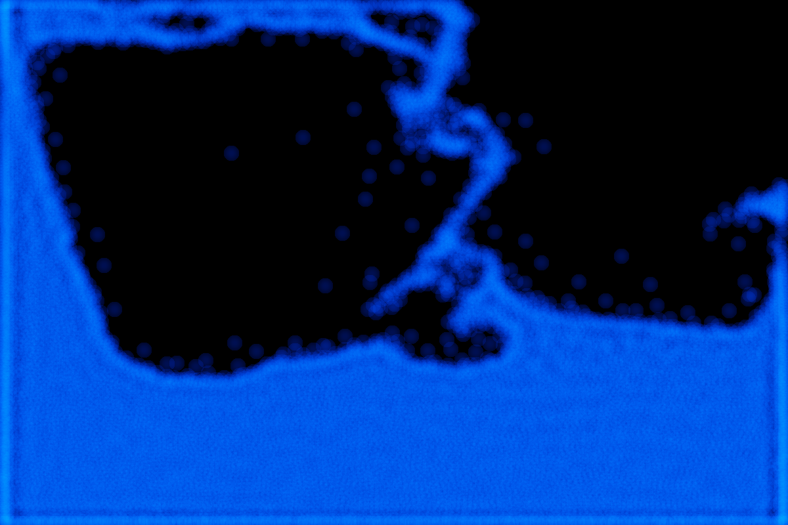

# SPH Fluid Simulation

A 2D Python fluid simulator using smoothed particle hydrodynamics and GPU acceleration with [Taichi](https://www.taichi-lang.org/).



> **Work in progress.** See [Status](#status) for known issues and what's next.

## Features

- Weakly compressible SPH with pressure, viscosity and surface tension forces, following Müller et al. (2003)
- GPU parallelism through Taichi (Metal on macOS, CUDA on Windows and Linux)
- Spatial grid neighbour search, with an all-pairs version kept for comparison
- Scenarios defined as YAML config files

## Running

```bash
python -m venv .venv
source .venv/bin/activate        # Windows: .venv\Scripts\activate
pip install -r requirements.txt
python main.py
```

Close the window to stop. Tested with Python 3.13 on macOS (Metal).

## Configuration

Scenarios live in `configs/`, the default is `splash_tank.yaml`.

## How it works

Each time step:

1. Particles are sorted into a grid of cells the size `h` (smoothing radius) so each particle only checks its own and neighbouring cells.
2. Each particle's density is found from its neighbours, and its pressure from how compressed it is.
3. Pressure, viscosity and surface tension forces are calculated in one pass over neighbouring pairs.
4. Particles are moved, then collisions with walls and other particles are handled.

| File | Contents |
|---|---|
| `main.py` | Entry point, interactive loop and frame timing |
| `src/solver.py` | Initialisation and the time step kernels |
| `src/physics.py` | Density, pressure and force calculations |
| `src/kernels.py` | Smoothing kernels and their derivatives |
| `src/neighbours.py` | All-pairs and spatial grid neighbour search |
| `src/integrator.py` | Time integration |
| `src/collisions.py` | Wall and particle collisions |
| `src/gui.py` | Rendering particles to an image |

## Status

Known issues:

- A particle collision step is still needed to stop particles clumping together. The cause is under investigation.
- Accelerations are clamped as a safeguard, which still triggers briefly during impacts.
- The 1 × 1 box is drawn in a 1200 × 800 window, so the display is stretched horizontally.
- `splash_tank.yaml` and `ripple_tank.yaml` predate the regular grid start and need `rest_mass` retuning.

Planned:

- Benchmark step time against particle count for the all-pairs and grid neighbour searches
- Validate against dam-break experimental data (Martin & Moyce, 1952)
- Tests for kernel normalisation and momentum conservation
- Choose the scenario from the command line

## References

- M. Müller, D. Charypar and M. Gross, "Particle-Based Fluid Simulation for Interactive Applications", *Proc. ACM SIGGRAPH/Eurographics Symposium on Computer Animation*, 2003.

## License

[MIT](LICENSE)
